# OpenTDU2

[](https://github.com/CamilleKMI/OpenTDU2/actions/workflows/macos.yml)
[](https://github.com/CamilleKMI/OpenTDU2/actions/workflows/linux.yml)


OpenTDU2 is an open source re-implementation (C++17 / Vulkan / Jolt Physics) of the engine of
**Test Drive Unlimited 2** (Eden Games, 2011).

The project is built on the structure of
[OpenTestDriveUnlimited](https://github.com/opentestdriveunlimited/OpenTestDriveUnlimited) (OpenTDU, the TDU1
re-implementation). It uses the same conventions: `GS*` game services, `GM*` game modes, original file formats
read as they are, the Jolt physics library, and D3D9 → SPIR-V shader translation through DXVK's DXSO compiler.

The original game is **not** included. OpenTDU2 reads the *unpacked* files of a legal copy (`Euro/Bnk`,
`Euro/Shaders`, ...: the layout used by the TDU2 Universal Launcher, not the `.big` archives).

Everything is read from the game files or from the **readable** code of `TestDrive2.exe`. About 3 MB of the
executable is encrypted by SecuROM; that part is never decrypted or bypassed. When a behaviour lives only there,
OpenTDU2 follows the data and marks the choice as inferred (`[INF]` in the code and in `docs/re/*.md`). See
[Grey areas](#grey-areas-what-is-approximate-and-why).

## Screenshots

| | |
|---|---|
| 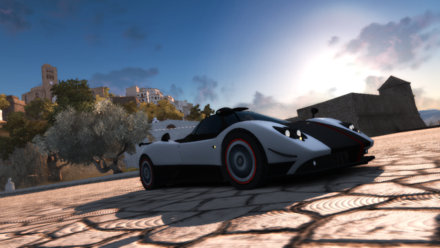 Press START screen (real-time cinematic of `press_start.bnk`) | 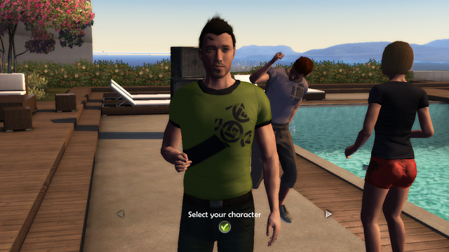 "Select your character" (C_AVATAR party in slow motion) |
| 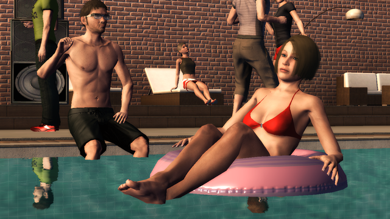 C_INTRO: pool water (refraction), reflections, avatar skin and faces | 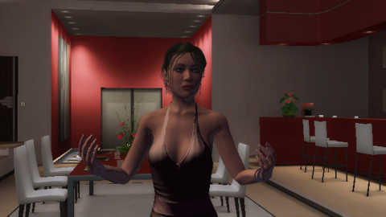 C_TESS: Tess talking (FaceFX lip sync), lighting from the house lamps |
| 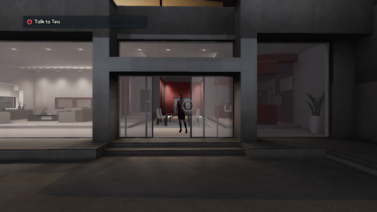 First-person walk mode, goal "Talk to Tess", reticle | 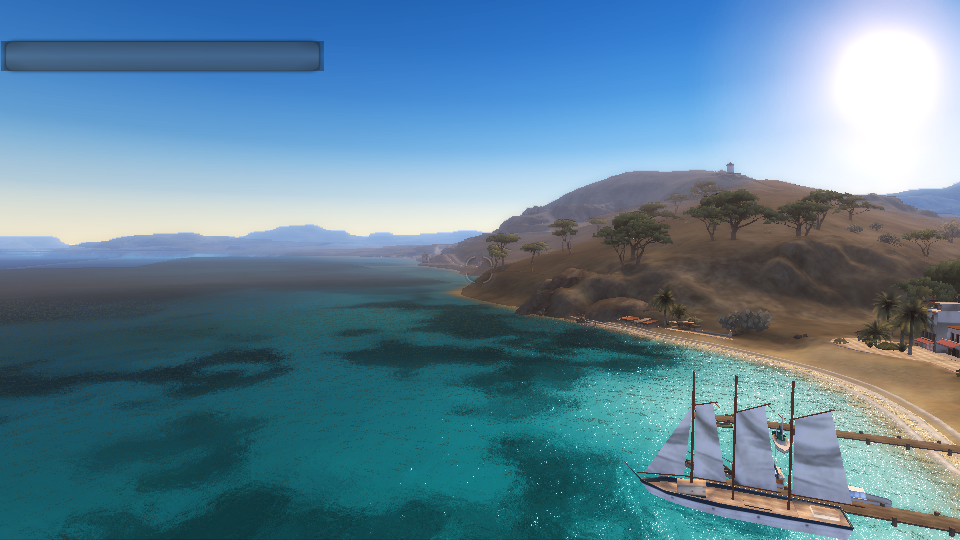 Ocean and shore foam over the bay |
| 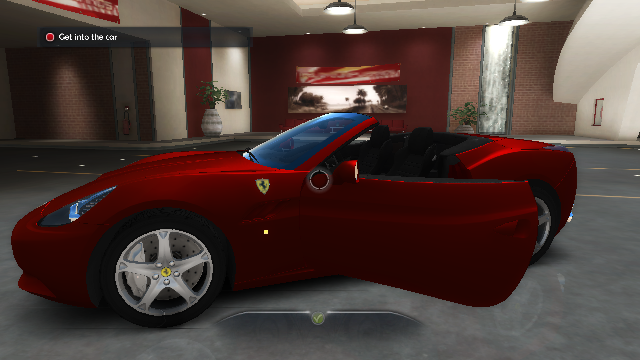 FIRST_WM garage: the California, roof down, driver door opening, untinted glass | 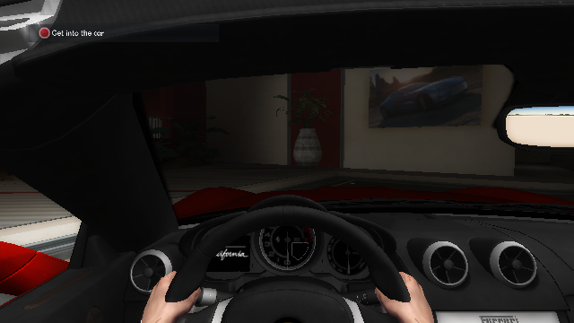 Seated in the cockpit, hands on the wheel |
| 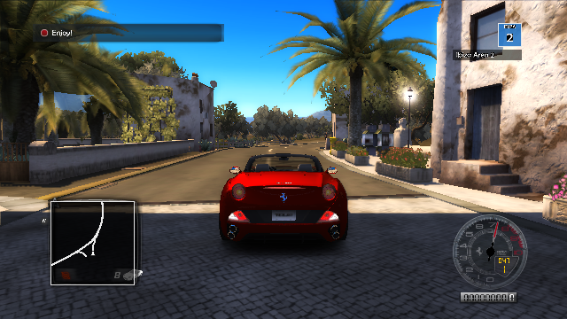 First Freeride: driving the California in Ibiza (Bienvenidos village) | 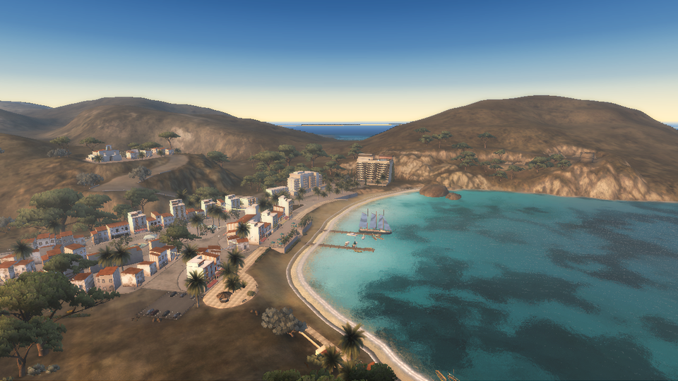 World viewer, Ibiza: village, beach and tall ship near the intro party house (spot `EPH_L3DI`, weather `19.30`) |
| 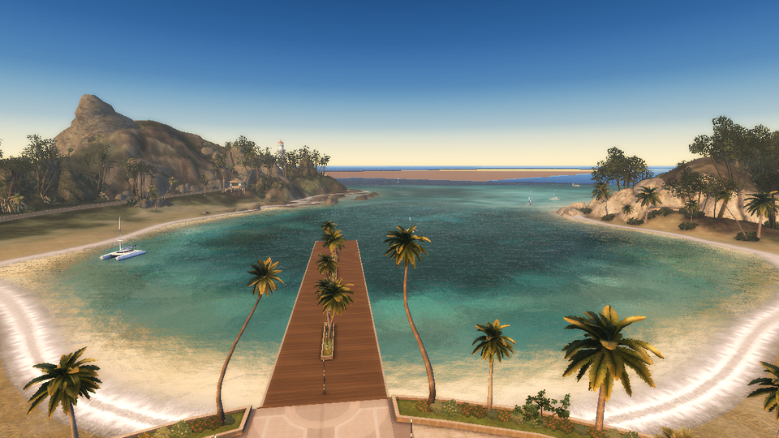 World viewer, Casino island: the bay and pier at sunset (weather `19.30`) | 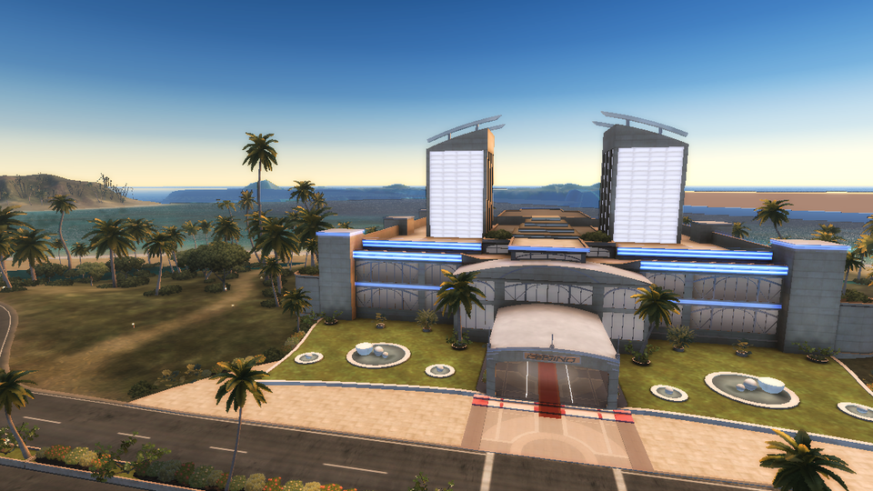 World viewer, Casino island: the casino (weather `19.30`) |
| 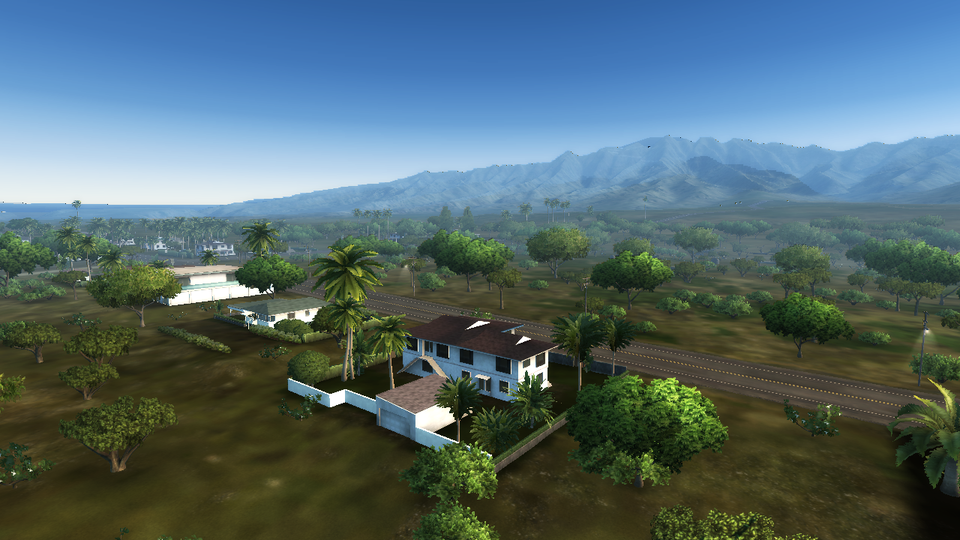 World viewer, Hawai (Oahu): houses and palms near spot `ETUN_G`, mountains behind (weather `18`) | 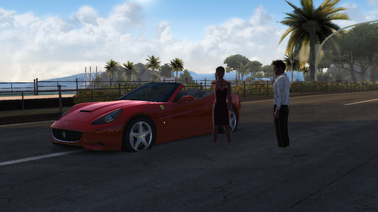 Story step 3 "Meeting Tess" (C_MEETING_TESS at the hotel `E_HOTELA_1266I`): the valet, Tess on the phone, the California |
| 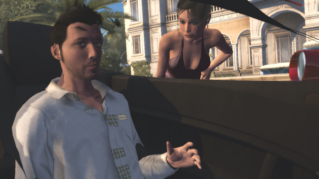 C_MEETING_TESS: Tess wakes the valet asleep in the California (FaceFX, avatar out of the dream in `AVT_Male`) | 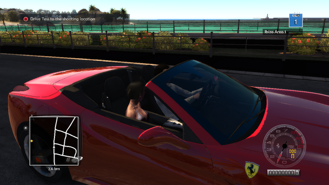 Story step 4 "Driving Tess" (MISSION, event TESSEVEN): Tess in the passenger seat (reaction `ev_tessincar_toplayer01`), goal, GPS marker |
| 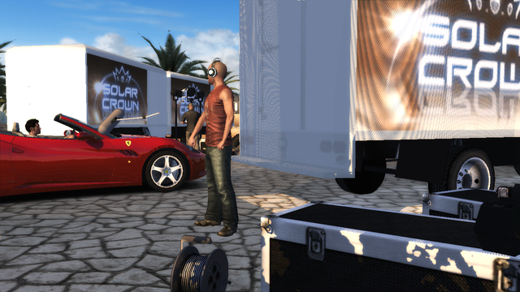 Story step 5: C_SOLAR_CROWN_E, the California arrives at the Solar Crown venue `ECH_IA_1243I` | 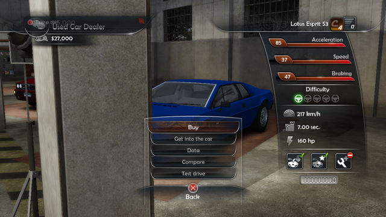 Story step 7: Todd Bishop's used car dealer, the Lotus Esprit S3 (Light Blue, 15 000 $), SHOPSCAR car data and mini menu |

## Build and run on macOS (Apple Silicon or Intel)

Requirements:

* Xcode Command Line Tools: `xcode-select --install`
* CMake ≥ 3.24 and Ninja: `brew install cmake ninja`
* The **LunarG Vulkan SDK** (provides MoltenVK): <https://vulkan.lunarg.com/sdk/home#mac>. It can simply be
  unpacked into `~/VulkanSDK/<version>`; the build script and the game find it there.
* Network access for the first `cmake` run: SDL3, volk, Vulkan-Headers, VMA, Jolt Physics, Dear ImGui and stb
  are fetched with `FetchContent`.

Build:

```sh
cd OpenTDU2
./build_macos.sh                 # configure + build in Release (folder build/)
```

or by hand:

```sh
cmake -S . -B build -G Ninja -DCMAKE_BUILD_TYPE=Release
cmake --build build --parallel
```

Run:

```sh
./build/bin/opentdu2                          # game data found automatically (see below)
./build/bin/opentdu2 -game /path/to/TestDrive2
```

The game data folder is looked up in this order: `-game <folder>`, the `OTDU2_GAME_DIR` environment variable,
the current folder, then the parent folders of the executable that contain `Euro/Bnk`. If the project sits
inside the game folder (`TestDrive2/OpenTDU2`), nothing has to be set.

Linux works too (tested with Mesa / llvmpipe). Windows should compile with MSVC but has not been tested.

### World viewer (developer tool)

A free-fly camera over an island, like OpenTDU's world viewer (game mode `WORLD_VIEWER`, not a TDU2 mode):

```sh
./launch_world_viewer.sh                 # Ibiza
./launch_world_viewer.sh casino          # Casino island directly (also: hawai)
./launch_world_viewer.sh hawai -game /path/to/TestDrive2 -time 18:00 -intempery Cloudy
```

The script finds the game data like the game does (`-game`, `OTDU2_GAME_DIR`, the parent folders of the
repository, a `TestDrive2` folder next to them, `~/TestDrive2`) and passes any other option to `opentdu2`
(`./build/bin/opentdu2 -gm WORLD_VIEWER -island casino` is the same thing).

* Look: hold the right mouse button (or the left one outside the panel); Tab = capture the mouse (look without a
  button, Tab again to release).
* Move: W / S (or Up / Down) = forward / backward along the view, A / D (or Left / Right) = strafe,
  E / Space / Page Up = up, Q / Ctrl / Page Down = down, **Shift = speed x2**, mouse wheel = base speed (x1.1 per
  notch, like OpenTDU), the camera stays 1.5 m above the loaded terrain ("ground clamp").
* Panel (ImGui, F2 hides it): island Ibiza / Hawai / Casino (also F5 / F6 / F7; the world is unloaded and the
  new island loaded), position / speed, base speed, FOV, sector radius, spot exteriors, the time of day and the
  weather, and the `spots.bin` list (click = teleport; the number is how many of the 9 sector banks around the
  spot are installed).
* Time of day / weather (the game's GSWeather evaluation of `fx/game_weathers.xmb`, `docs/re/weather_spec.md`):
  hh:mm slider and shortcuts, clock speed (frozen by default, "game x9.6" = the game clock, 24 h in 2.5 h),
  weather type of the current and of the next 2-hour forecast slice (Sunny, Cloudy, Rainny, Before_rain,
  After_rain, Tempest: the blend runs over the slice), or a fixed preset (`specific_weathers.xmb`,
  `cinematic_weathers.xmb`), and a Rain checkbox (default off, `-rain`: falling rain, drops, splashes and the
  rain sound; values of the weather when it rains, else those of the Rainny weather type at the same hour; the
  sky stays the weather's, `docs/re/rain_spec.md`). Sky, sun, moon, haze, fog, lights, clouds
  (rotation, fade between cloud sets), ocean, neons and lightmaps follow live.
* Streaming follows the camera: the sectors around it (radius 1, `-sectorradius n`) are loaded and the ones two
  rows away unloaded; every area bank, the island ocean and the island level heightfield (`<island>.bnk`, drawn
  where no area is loaded) stay loaded; spot exteriors (`exterior/<spot bank>.bnk`) within 1.5 km, with their
  particle effects (the Casino garden fountains, the Ibiza hotel water sheets, `docs/re/particles_spec.md`) and
  their 3D sound loops (Casino fountains, listener = the camera; `-audiodump file.wav` mixes offline without an
  audio device); the island ambient effects of the loaded sectors (farm / factory smoke, river steam: `-F.pmi` +
  `fx/vfx_env.bnk`, started within their trigger distance, `-noworldfx` to turn them off; also in FREERIDE).
* Missing banks are skipped with a warning (partial game data). The start position is the `spots.bin` spot with the
  most sector banks installed around it (`-spot <bank name>` to choose, `-campos x,y,z -camyaw deg -campitch deg`
  to place the camera, `-flyspeed m/s`, `-noexteriors`).

### Free drive (sandbox tool)

Drive any installed car of the database on the roads of Ibiza, Hawai or Casino and switch car at any time, like
OpenTDU's sandbox (game mode `FREE_DRIVE`, not a TDU2 mode; the story FREERIDE is unchanged). Details:
[docs/free_drive.md](docs/free_drive.md).

```sh
./launch_free_drive.sh                       # Ibiza, Ferrari California
./launch_free_drive.sh casino                # Casino island
./launch_free_drive.sh ibiza mustang         # car: a word of its name, a _car_file_name or an _id_car
./launch_free_drive.sh hawai esprit -time 19:30 -game /path/to/TestDrive2
```

The script finds the game data like `launch_world_viewer.sh` and passes the other options to `opentdu2`
(`./build/bin/opentdu2 -gm FREE_DRIVE -island ibiza -car California` is the same thing).

* Start: a `spots.bin` spot (the one with the most sector banks installed, or `-spot <bank>`), its street side
  transform snapped on the nearest road surface (sector `-R.shk`); `-carpos x,y,z -carheading deg` to choose.
* The car: `vehicules/high` bank, interior, DB rims and tyres, DB colours (`DBCarsAndColors`), physics from its
  `DBCarPhysicsData` row, its `CamerasInGame.xmb` cameras, HUD with its gauge bank, lights and accessories. Only
  the cars whose `vehicules/high/<car>.bnk` is installed are listed (`-listcars` logs all of them with the banks
  they need).
* Keys (no numpad needed, Mac keyboard OK; on a Mac laptop the F keys may need `fn`):

  | Action | Keys |
  |---|---|
  | Throttle / brake-reverse / steer / handbrake | Up / Down / Left / Right or W / S / A / D, Left Shift |
  | Camera | C |
  | Accessories (roof, windows, blinkers) | 4, then 8 / 2 / 4 / 6 |
  | Back on the road (stopped, on the nearest road) | **F3** or B (the game's `BACK_ON_TRACK` key) |
  | Next / previous car (switched at the same place and speed) | **F4** / Shift+F4 |
  | Next colour | F8 |
  | Lights off / auto (weather) / high beam | F9 or Enter (the game's `CAR_LIGHT` key) |
  | Island Ibiza / Hawai / Casino | F5 / F6 / F7 |
  | Panel / debug UI | F2 / F1 |

* Panel (ImGui, mouse): island, speed / position, back on the road, HUD on / off, car list with a filter (click =
  switch now), colour, lights, hazard lights, time of day / weather (same controls and options as the World
  Viewer: `-time`, `-timespeed`, `-intempery`, `-weather`, `-rain`), spot teleport list, controls.

### Command line options

| Option | Effect |
|---|---|
| `-game <folder>` | game root folder (the one that contains `Euro/`) |
| `-lang fr` | text language (`db_<lang>.cpr`); default: system language |
| `-w`, `-fullscreen`, `-width N`, `-height N`, `-novsync` | video (otherwise `SystemPC.cpr`) |
| `-gm <mode>` / `-intro` | start in a game mode: `LOGIN`, `AVATAR_CHOICE`, `FIRST_WM`, `FREERIDE`, `CINE`, `MISSION`, `SHOP`, `TESTCAR`, `WORLD_VIEWER` (tool), `FREE_DRIVE` (tool) |
| `-storystep n` | start at story step n: 0 AVATAR_CHOICE, 1 FIRST_WM, 2 FREERIDE, 3 CINE "Meeting Tess", 4 MISSION "Driving Tess", 5 CINE "Solar Crown exterior", 6 CINE "Solar Crown interior", 7 SHOP "Used Car Dealer", 8 FREERIDE "Tuto FROG" (hand-off stub) |
| `-cinekind n`, `-cinetime s` | CINE: cinematic kind (1 = C_MEETING_TESS, default; 2 C_SOLAR_CROWN_E, 3 C_SOLAR_CROWN_I) and start time (tests) |
| `-startnearfinish d`, `-reactiontimer s`, `-carcam dx,dy,dz` | MISSION tests: start d m before the finish gate; first Tess reaction timer (40 s in the game); fixed view from a car-local point |
| `-steptimer s` | FREERIDE: story step 2 timer (90 s in the game) shortened for tests |
| `-startstopped`, `-chaseorbit deg` | FREERIDE tests: start at 0 km/h; chase camera turned about the car (side views) |
| `-fixedtimestep [-fixeddt ms]` | fixed game time step (1/60 s, or `ms` milliseconds, at most 100: long animations such as the 17 s roof in few frames) |
| `-indicator left\|right\|hazard`, `-carlights 0\|1\|2`, `-nolightboxes` | FREERIDE car lights tests: force the blinkers, the light mode (0 off, 1 weather driven = default, 2 headlights forced), hide the projected light boxes (`docs/re/car_lights_spec.md`) |
| `-noflares`, `-noprojector`, `-nobeams`, `-beamintensity x`, `-tunnel 0\|1`, `-logtunnel`, `-showheadlights`, `-loghl` | FREERIDE / FREE_DRIVE car lights: hide the flare sprites, the projected headlight (HEADLIGHTS pass), the light beams; force car_lightbeam_intensity, the tunnel state; log the road network tunnel distance, the headlight spot; show HeadLightsRT (`docs/re/car_lights_spec.md` 6 to 9) |
| `-island <name>` | WORLD_VIEWER / FREE_DRIVE: `ibiza` (default), `hawai`, `casino` |
| `-car <name\|id>`, `-color <index\|id\|name>`, `-carpos x,y,z`, `-carheading deg`, `-listcars` | FREE_DRIVE: car (`_car_file_name`, `_id_car` or a word of its name; default California), colour, start pose, log of the database cars and their banks |
| `-noworldfx` | WORLD_VIEWER / FREERIDE / FREE_DRIVE: no island ambient effects (sector `-F.pmi` smoke / steam) |
| `-norails` | WORLD_VIEWER / FREERIDE: no guard rails (sector `-S.pmi` skinned instances; comparisons) |
| `-time hh:mm[:ss]`, `-timespeed x` | WORLD_VIEWER / FREE_DRIVE: time of day (default 14:00) and clock speed in game seconds per second (default 0 = frozen; the game runs at 9.6) |
| `-intempery <w>`, `-nextintempery <w>` | WORLD_VIEWER / FREE_DRIVE: weather type of the current / next 2 h slice (`Sunny` default, `Cloudy`, `Rainny`, `Before_rain`, `After_rain`, `Tempest` or 0..5) |
| `-rain` | WORLD_VIEWER / FREE_DRIVE: Rain checkbox on at start (falling rain, `docs/re/rain_spec.md`) |
| `-weather <name>` | WORLD_VIEWER / FREE_DRIVE: a `game_weathers.xmb` key (`14`, `21.30`: sets the time) or a fixed specific / cinematic preset (`INTRO`, `Avatar`); FREERIDE / MISSION: the time key (default `14`) |
| `-audiodump <file.wav>` | no audio device: the mixer runs offline at the game time step and the mix is written to a WAV file (tests; `OTDU_AUDIO_LOG=1` logs every voice) |
| `-skipintro` | AVATAR_CHOICE: skip C_INTRO, straight to "Select your character" |
| `-walkmode n` | AVATAR_CHOICE: avatar n (1..6) chosen, straight to the house walk mode |
| `-avatar <config>` | FIRST_WM / FREERIDE started directly: DBPNJ avatar config (default `AVT_Male_Intro`) |
| `-allowskip` | FIRST_WM: the garage intro can be skipped |
| `-skipcine` | FREERIDE: skip C_FIRST_OUTRO, start on the road; SHOP: skip C_FIRST_INTRO, start in the walk mode |
| `-testcar id`, `-testtime s` | TESTCAR tests (`-gm TESTCAR`): car id (default 371), duration instead of 120 s |
| `-money n`, `-walkat x,y,z,yaw` | SHOP tests: player money (27 000 $ for a new story profile); walk mode start (scene-local eye position, yaw in degrees) |
| `-no3d` | FREERIDE / CINE / SHOP: logic tests without the 3D rendering |
| `-playername <name>` | name shown in "Starring" (no profile yet; default: system user name) |
| `-envquality n` | `ENVIRONMENT_QUALITY_LEVEL_n` of `Quality_Settings.cpr` (0..3, default 3 = max; the game without a save uses 1) |
| `-FORCELOGINCINEINDEX n` / `-cine n` | title screen cinematic (0..3, `entities.xmb` order); R key = next one |
| `-nosob` | do not use the original `.sob` shaders for the 2D layer |
| `-vk_enable_validation_layer` | Vulkan validation layers |
| `-verbose` | detailed log in `opentdu2.log` |
| F1 | debug UI (ImGui) |

### Controls

Bindings come from the game's `Default_KB.xmb` (plus WASD); a gamepad (SDL) is supported.

* Menus: arrows, Enter = validate, Backspace = back, Esc = pause. "Select your character": left/right, Enter or
  mouse click.
* Walk mode (house, garage): arrows / WASD = move and strafe, mouse or right stick = look, Enter = act on what the
  reticle points at (the "Garage" door, the car). Open the car door: **numpad 4** (`ACCESSORIES_LEFT` in
  `Default_KB.xmb`), main-row **4** (OpenTDU2 binding) or the d-pad left.
* Car: Up / W = throttle, Down / S = brake / reverse, Left / Right = steer, Left Shift = handbrake, C = camera.
* Car accessories (FREERIDE, `docs/re/accessories_spec.md`): open the "Accessories" menu, then pick an item
  within 4 s (the menu closes by itself). Keys of `Default_KB.xmb`, plus OpenTDU2 main-row digits for keyboards
  without a numpad (Mac); the original keys keep working:

  | Action | Original key (`Default_KB.xmb`) | Mac / no numpad (OpenTDU2) |
  |---|---|---|
  | Open the accessories menu (`ACCESSORIES_LEFT`) | numpad 4 | **4** (main row) |
  | Menu: roof open / close (`ACCESSORIES_UP`) | numpad 8 | **8** (menu open only) |
  | Menu: windows down / up (`ACCESSORIES_DOWN`) | numpad 2 | **2** (menu open only) |
  | Menu: left blinker on / off (`ACCESSORIES_LEFT`) | numpad 4 | **4** |
  | Menu: right blinker on / off (`ACCESSORIES_RIGHT`) | numpad 6 | **6** (menu open only) |
  | Windows down / up directly (`CAR_WINDOWS`) | W on AZERTY (Z on QWERTY) | same key |
  | Left blinker directly (`CAR_LEFT_BLINKER`) | right Ctrl | use the menu: 4 then 4 |
  | Right blinker directly (`CAR_RIGHT_BLINKER`) | numpad 0 | use the menu: 4 then 6 |

  The roof takes 17 s (California `Hardtop.anm`) and cannot be reversed while it moves; the windows take 3 s.
  Keys are key positions (the digit keys work without Shift on an AZERTY Mac).

## Status: done and to do

| Area | Done | To do |
|---|---|---|
| Game files | `.bnk` banks, XMB (`XMBF`, both endians), encrypted `.cpr` (XTEA), database `db_data.cpr`, localisation `db_<lang>.cpr`, `SystemPC/GamePC/Physics/Quality_Settings.cpr`, `Default_KB.xmb` | `.big` archives, save games (format is in encrypted code) |
| Rendering | Vulkan (volk + VMA, MoltenVK); original `.sob` shaders translated D3D9 → SPIR-V for the 3D and the 2D layer; `.2db` (incl. cube maps), `.3dg`, `.3dd`, `.2dm`; `.UVA` texture animations; shadows (cascades + combine), post FX, haze, sky, clouds, weather presets; ocean with shore foam; GSReflection pool water (refraction / mirror projectors); interior day/night lightmaps; falling rain (rain blocks, drops, splashes, rain sound) and wet roads; night lighting of the world (street light maps on the ground, night windows, spot exterior lamp halos, neons) | Screen droplets and lightning, dynamic street lamp lights on cars, street lamp light beams, traffic lights, more post FX variants |
| World | Ibiza sectors and areas streaming, `.pmi` instances with the game's LOD factor, guard rails (`-S.pmi` skinned instances bent along the road by their per instance bones), house spot placement, exteriors and interiors; area grid from `worldconfig.cpr` (Ibiza 7 x 6, Hawai / Casino 11 x 9), sector unloading, island level heightfield, library LODs (LOD 1 / 2 meshes, `TD_HardwareInstance` low buildings) and tree impostors (`TD_Impostor` camera facing quads, mesh to impostor colour fade) at the game's distances | Map mode, asynchronous loading |
| WORLD_VIEWER (tool) | Free-fly camera over Ibiza, Hawai or Casino (`launch_world_viewer.sh`), mouse look, WSAD, Shift x2, ImGui island switch, `spots.bin` teleport, spot exteriors, time of day / weather types / presets (GSWeather blend), rotating clouds, moon | Traffic, roads / collision debug views |
| FREE_DRIVE (tool) | Drive any installed DB car on Ibiza, Hawai or Casino (`launch_free_drive.sh`): start on a road near a spot, back on the road (F3), instant car switch at the same place and speed (F4, panel list), DB colours, rims, interior, physics, cameras, gauges, lights, accessories, spot exteriors with their collision, World Viewer weather panel, spot teleport | Road network (snap on the road surface instead), traffic, engine sound, driver avatar |
| Flash UI | VMF reader, Eden fonts, display list, AVM1 ActionScript, buttons (keys + mouse), masks, EditText layout from the exe, `sbdd` localisation, font shader (TD_Flash PS #7), inline `#bitmap:` icons (`$$bitmaps$$` registry), `#command:` keys (orange `[key]` text on keyboard, like the original), case-insensitive names, Array objects, GENERAL dialog boxes (`dbxo` / `dbxc`) | Pad key maps (the default X360 button binding is not in the data), some rare AVM1 opcodes |
| Audio | Eden mixer rebuilt from `audiosetup.xmb` (clients, routing matrices, mix presets, ducking), 3D positional sounds, cinematic Fx, voice banks per language, spot exterior fx loops (Casino fountains) | User volume sliders, ambiance emitters, engine sound model |
| Avatars | DBPNJ configs, bodies, heads, clothes, hair colours, body zones, skin constants (freckles, age, tone), skeleton animation with crossfades, style animations (m/w), avatar lighting (house lamps, camera light, shadow influence), driver seating (`IKOffsetDB.bin`, `stance_turn`, hand/foot/back IK targets), FaceFX facial animation in the intro / garage cinematics (`.fxa` actors, `.fxe` lip-sync curves, face graph, face shape sliders, expression normal maps) | FaceFX look-at, FaceFX outside the intro cinematics, finger grip and steering blend while driving |
| LOGIN | 3D press start cinematics, LOG_IN2.vmf, press start, "no progression data" popup | Profile / save game loading |
| AVATAR_CHOICE | C_INTRO with credits and slow motion, "Select your character" (6 candidates, transitions, slow-motion party and music), C_FIESTA_INTRO, first-person walk mode with Havok collisions, "Talk to Tess" → C_TESS → "Go to the garage", garage door | — |
| FIRST_WM (garage) | Garage intro, Tess and her voice lines, the California (roof down, cockpit LOD), tips ("Astuce") from `DBTutoMess`, door opening, enter the car, cockpit view with hands on the wheel, engine start → C_OUT / C_OUTRO | — |
| FREERIDE | Story step 2: C_FIRST_OUTRO, car on the road, car lights (brake, reverse, blinkers, position lights / headlights at night from the weather, lamp glows and projected light boxes, flare sprites of the cars that have them, projected headlight on the scene (HEADLIGHTS pass), light beams, tunnel detection from the island road network switching to the tunnel light values, `docs/re/car_lights_spec.md`), driving (edVehicle drive train, controllers and aids from the exe, 90 Hz), collisions (roads, terrain, world objects), chase camera from `camerasingame.xmb`, HUD (goal, zone badge, minimap, GAUGES movie with the California rev counter, speed, gear, odometer), accessories menu (`HUD/ig_menu`: roof, windows, blinkers), 90 s then C_FADE_FREERIDE (white fade, Tess knocks) → story step 3 | Traffic, other cars, shops, houses, the radio menu (`ACCESSORIES_RIGHT`), the UI sound cues (`sndp:ig_open` ...) |
| CINE (story steps 3, 5, 6) | "Meeting Tess": `meeting_tess.bnk` at the hotel `E_HOTELA_1266I` (exterior, world streaming), C_MEETING_TESS / C_MEETING_TESS_W (66.7 s, fade in from white): the avatar out of the dream (`AVT_<sex><ethnic>` valet outfit, hair and beard kept), Tess (FaceFX, voices), the California (doors from the scene messages), the phone and the Ferrari key (skinned props, visibility tracks), cinematic weather / shadows; end → story step 4. "Solar Crown": C_SOLAR_CROWN_E (kind 2, `solar_crown_ext.bnk`, the car arrives at `ECH_IA_1243I`, avatar `avm4` / `avm1`) → C_SOLAR_CROWN_I (kind 3, `solar_crown_int.bnk` + `Interior/ich_ib.bnk`, 107 s TV set with Tess and Todd Bishop) → story step 7 (`docs/re/story_spec.md`) | The exact scene placement [ENC] |
| MISSION (story step 4) | "Driving Tess": DBEvent TESSEVEN, the IGE2 event script `ig2/tesseven.ig2` (parameters, checkpoints), `pack_events13.bnk`; CGameMech states 2 → 4 → 5 → 8 → 9; the California from the start gate, FREERIDE driving / camera / HUD, goal 4032, GPS marker; the player seated at the wheel and Tess (`STO_Tess_Phone`) in the passenger seat (`SHO_stand_car`, IK, IKOffsetDB passenger record); Tess' reactions (E13_TESS: 40 s / 25 s timers, impacts) with FaceFX and voices; C_TRUCK (Solar Crown trucks) at the venue; arrival at the finish gate → the event reward (`rewm` 20 000 $, pending money + the 1 s money counter: 47 000 $ at the dealer) → story step 5 | Race start / finish tests and the RESULTS screen [ENC/INF], traffic, other event types |
| SHOP (story step 7) | Todd Bishop's used car dealer `ESTOL_B_1275I`: `interior/istol_b.bnk` + `estol_b.bnk` exterior, C_FIRST_INTRO (Todd's welcome, FaceFX, voices) then C_FIRST_LOOP, the loaned Dino, the three used cars of DBCarShop[25] on their stands (Mustang Fastback 68 Raven Black 24 500 $, Esprit S3 Light Blue 15 000 $, Delta Integrale Evo 2 Dealers Collection 20 000 $: DB price + rims + colour, high banks, rims, paint from `<car>_color.2dm`), walk mode, goal "Buy a car!", SHOPSCAR car data panel and mini menu, price check, GENERAL dialog boxes (confirm / "Not enough money!"), purchase (garage + money), C_EXPLAIN_FROG → FREERIDE story step 8 (stub); mini menu **Enter** (driver seat of the showroom car with driver IK, cockpit camera, look around, exit), **Data** (full data sheet), **Compare** (`comp` record vs the next car), **Test drive** (TESTCAR, back to the dealer with C_INTRO_I) (`docs/re/story_spec.md` 5.2) | Todd's C_CHOICE_TODD menu, the used stock after step 11, steps 8–10 |
| TESTCAR (test drive) | The dealer car (DB banks, colour, rims) driven with FREERIDE physics from the dealer's street, the player at the wheel and Jude (SPT_Jude) as passenger, HUD 120 s countdown (`/HUD/time_cd`, `/:IsTest`), end (time out / pause) → SHOP (`docs/re/story_spec.md` 5.2.5) | The road-network start pose (spot second transform instead), the pause menu |
| Not started | | Online, multiplayer, Casino and Hawai gameplay (both can be flown over in WORLD_VIEWER and driven in FREE_DRIVE), challenges, races, missions, map, phone, dealerships |

## Grey areas: what is approximate and why

The rule of the project is to read behaviour from the data or from the readable code. The items below could not be
read completely, mostly because the code that decides them is in the SecuROM-encrypted part of the executable.
Each one is marked `[INF]` (inferred) in the sources and documented in `docs/re/`.

| Topic | What is approximate | Why |
|---|---|---|
| Car driving | The chassis constraint solver (contact / suspension force law, rigid body integration), the RK4 combination of the drive train stages, the contact coupling of the tyres to the chassis, a few predicates (idle / limiter thresholds, ABS / TC activation, shift speed getters), wheel and chassis inertia, ground materials (grass = terrain) | TDU2 cars use Eden's own `edVehicle` library, not the Havok vehicle SDK. The 90 Hz step, the drive train (engine torque / damping / speed clamp, clutch, gearbox, open differential with its bias limit, wheel axles with the car inertia share and the tyre torque at every stage), the engine / clutch / gearbox controllers (automatic shifts at the red / blue lines), ABS / traction control / hand brake regulation, aero anchors and damping curves are read from the code; the chassis core of `edVehicle` is in the encrypted part (see `docs/re/vehicle_physics_spec.md` §6 - 7) |
| Chase camera | Camera motion (lag, lean, shake) | Positions and FOV come from `camerasingame.xmb`; the update code was not found |
| HUD | Minimap road drawing, zone lookup, which gauge-bank texture is the dial / the needle, in-car DASHBRD screen not drawn | Map drawing and zone lookup are encrypted; texture arguments are lost in the readable code |
| Walk mode | Mouse sensitivity, body radius (0.3 m), step height, strafing on left/right | The walk controller and its camera are encrypted; speeds and head limits come from `avatarsdriver.bnk` |
| Tips and goals | When each tip opens and closes; "Talk to Tess" shown when walk mode starts | Texts and delays come from `DBTutoMess`; the trigger conditions are encrypted |
| Seated avatar | The IK solver (analytic two-bone), seat adjustment added to the seat node, head hidden in the cockpit view | Seat node, `IKOffsetDB.bin` offsets, driving clip and IK targets come from the data and readable code; the Havok IK solver, the seat move and the cockpit render branch are encrypted |
| Avatar lighting | Lamp distance fall-off (linear from DropOff to CutOff), light sample point (feet + 1 m), camera axis | Small helper functions are encrypted; everything else follows the readable code |
| 3D sound | Attenuation curve and panning law | The edAudio spatializer is encrypted; distances, clients and matrices come from the data |
| Cinematics | Shot fade parameters, start-of-cinematic skip input, roof state in the garage (open, from the general convertible rule) | Read from data and partial code; the shot / scene code (CinScene) is encrypted |
| Story step 3 | Where C_MEETING_TESS is placed: the scene is put so that its PLAYER_CAR stands at the spot's second transform (spots.bin +0x28 / +0x38); the white screen of C_FADE_FREERIDE | The CINE mode builds the cinematic matrix from the car driver matrix with encrypted helpers; nothing in fade_freeride.bnk draws the white |
| Story step 4 | Start pose (the first checkpoint of tesseven.ig2), finish test (within the 7 m gate width of the last checkpoint), race start, the random mapping of Tess' reactions, their 0.3 s blend and track player, the passenger IK goals, the C_TRUCK frame (spot transform), the impact threshold | The racer object, the IGE parameter reader (FUN_00492be0), FUN_006c8f00 and FUN_0045f2f0 are encrypted or not identified; the IGE format, states, timers and data are read from the exe and the files |
| Story step 7 | Pad / keyboard routing to the SHOPSCAR and GENERAL movies (validate = key 13, back = B()), car hit boxes (body bounds), metric units, collection discount 0, C_FIRST_INTRO always played, car names (brand + model + version); the shop in-car look input, the test-drive start (spot second transform), the step 4 reward counter run at once (RESULTS not shown) | The input routing, the car wrapper hit test, the unit option, the collection points and the car descriptor name are in encrypted code; prices, colours, rims, texts and the whole SHOPSCAR / GENERAL logic come from the data and readable code (`docs/re/story_spec.md` 5.2) |
| Story steps 5 / 6 | Solar Crown scenes in the spot frame of ECH_IA_1243I; `avm4` / `avm1` seat / unseat the avatar | Same CINE placement helpers [ENC]; the avm handlers are encrypted |
| Pool reflections | Avatars in the mirror layers are on | The intro-mode check is encrypted; the original layer setup includes them |
| Ocean | Swap rule between island, area and sector ocean tiles (finest loaded level wins: island `Area-x-y` tile hidden under a loaded area, area `Sector-x-y-sx-sy` group hidden under a loaded sector); foam texture addressing (mirror) | The per sector node tables of the area (FUN_00992890) and the island `Area` / `Border` nodes (FUN_008be5c0) are filled in readable code, the per frame show / hide that uses them is encrypted; the 2DM sampler byte meaning is not readable |
| World viewer | Island level heightfield (`<island>.bnk`, 384 m grid, -100 m off the coast so it stays under the sea) drawn where no area is loaded; spot exteriors placed from `spots.bin` (bank name -> `exterior/<name>.bnk`, position, heading); streaming distances and camera speeds | The level LOD selection is encrypted; the tool values (speeds, distances, sensitivity) are OpenTDU2's own, the wheel steps come from OpenTDU |
| Neon signs | Blink phases and speeds are random like in the game but seeded from a stable key (the game seeds from a heap pointer, so no two runs match); the random generator is taken as the LCG of the readable code; the sector / area object scenes count as one model instance each, a .pmi instance's blinking materials are those drawn by its library node | The registration (FUN_00985e40), the per frame update (FUN_009834d0, FUN_009821a0), the blink formula and the shader use are read from the code and the shaders; the generator (FUN_005abe00) and the parameter block attach (FUN_00448310) are encrypted (`docs/re/neon_spec.md`) |
| Particle effects | The whole particle behaviour of the spot exterior effects (ECAS fountains, hotel water sheets, butterflies): emission, cone, gravity, curves over the life (size, colour, alpha), atlas frames, sorting; the spawn shape other than a point; the axis of the fountain quads (taken as the motion direction); the soft particle depth source (the screen depth buffer, from the exact decode match; one pixel of half texel shift) and a restarted ambient effect starting empty | The particle engine (edFxParticles) is entirely encrypted; the .prt values, the curves, the placement chain (spot Entity__Fx, sector `-F.pmi` with the trigger distance rule of FUN_00c38b10) and the TD_Particle shaders are read from the data and the readable code (`docs/re/particles_spec.md`) |
| Fountain sounds | Distance curve (1 up to ClipNear, 0 at ClipMid) and pan law; the World Viewer mix preset (FREERIDE) | The sounds, volumes, clip distances and client come from the bank and its .bfx; the edAudio source is encrypted (`docs/re/sound3d_spec.md` 4.6) |
| Weather / sky | The float3 / float4 parameter blend (taken as linear like its readable twins), the cloud rotation axis (vertical), the dome cloud meshes drawn with the cloud set of their letter, one draw when both forecast slots hold the same cloud set, no stars, the forecast slices chosen in the panel (offline the game gives Sunny everywhere) | Key choice, key and forecast blend factors, string switch at 0.5, clock speed 9.6, cloud set lookup, rotation speed, cloud alpha / colours and the moon placement are read from the code; the parameter lookup, the vector blend, the rotation matrix and the star vertex generator are encrypted (`docs/re/weather_spec.md`) |
| Rain | The drops and splashes follow the camera (the game uses the player car frame); the car speed factor (rain slant, scroll boost) is 0; the rain sound volume law (`Volume * Curve(rain_alpha / 255)`); screen droplets and lightning not drawn | The rain blocks, drops, splashes and their constants are read from the code (`docs/re/rain_spec.md`); the speed factor is written by encrypted code, the ambience manager update was not found |
| Car lights | Which GLOSSFCT channel each lamp function drives (brake r, reverse g, position / headlights b, blinker 1 - a: from the colour of the lamp-on texture under each mask), the lamp side from the material name, the lamp glow meshes and flare sprites shown with their function (the "LBSWR" letters read as front lights, rear position, stop, warning, reverse), brake = brake pedal > 0, light mode 1 by default; the driver road position is the nearest road centre line; projected headlight: Spot_Color 1, the spot height from the car body size, cos / tan for two encrypted helpers, the projector texture by name; light beams placed at the front lamp nodes with the car orientation | The light material table, the per frame light logic (weather values, light modes, high beam delay, blinker period 1 s / 0.6 s lit), the projected brake / reverse / headlight boxes, the lamp / flare node names (FUN_00c5f060), the tunnel rule (FUN_00c62a70 / FUN_00c41d20 on the ROAD_DETAIL sections of type 6), the headlight manager constants and the HEADLIGHTS shader constants (FUN_00921d90, FUN_009208f0, FUN_009227c0, FUN_00923230, `edrender_pfx_lightness` ps_1 / ps_0) and the beam parameters (FUN_00964b90) are read from the code; the lamp setters and lamp matrices are encrypted (`docs/re/car_lights_spec.md`) |
| Night lighting | Street lamp lights (`streetlamps.xml`, sector `.lmp`) are not applied to moving objects; spot exterior lamp halos take the node colour as white | The world street light is baked in the sector maps and driven by `outside_street_lightmap` (read from the code and shaders); the reader of the lamp table and of the `.lmp` files is not in readable code. The street light map of the `.pmi` rocks / concrete sets (library TD_Ground materials) comes from the O / S list override record (sector `-s` map) and the instance `sectrOff` written by readable code; how the encrypted submit applies the record (taken as the SHADOW slot, mirror addressing) is inferred (`docs/re/night_lighting_spec.md` 2.1) |
| Spot exterior textures | A texture slot left empty when its exterior was loaded is looked up again once the neighbouring exteriors are in (ECAS tower glass reflection = the `cubemap` of elandca.bnk) | The resolver of the 2DM texture references is encrypted (`docs/re/spot_exterior_spec.md` 5) |
| Distant objects (LODs, tree impostors) | The impostor quad: camera facing around the vertical axis, side view = view angle x NbImpostorSide / 2 pi (rounded), top view cell unused; the mesh fade written to `__Lod_Dist.z` as 1 - blend; `impostor_ambient` as the second ambient light; the plain (not dissolve) TD_Impostor permutation | The LOD distances, the LOD factor rule, the impostor decision and blend, the batches and the material settings are read from the code (`FUN_00989d10`, `FUN_009969e0`, `FUN_00989b50`, `FUN_00996470`); the per impostor vertex builder and the binding of the blend and of the lights are encrypted. The view to atlas cell mapping is checked on the LOD 0 tree silhouettes (`docs/re/lod_impostor_spec.md`) |
| Guard rails | Rails cast no shadow (OpenTDU2 builds no skinned shadow caster; what the game does is not known); no distance limit inside the loaded sectors (the game's per cell draw distance of the S list is written by encrypted code); culled with their record AABB instead of the game's 25 m bounding radius; the companion model the loader attaches to each rail (FUN_009884c0, a 3-entry runtime hash remap) is not drawn | The bone payload, its order (`v . Bone . World`) and the skinned TD_Ground shader are read from the code, the shader and the data (rail ends meet within 1-2 cm); the code that uploads the palette (after FUN_004dc650) and the remap table filler are encrypted or have no readable caller (`docs/re/pmi_spec.md` 1.5) |
| Animations | Walking clips "jump" at their loop point | This is the game data itself: the readable time controller wraps exactly like OpenTDU2 |

## Code layout

```
source/
  core/          logger, assert, maths, memory, XMB, CPR crypto
  system/        command line
  filesystem/    GSFile (game root, case-insensitive paths), Bank (.bnk)
  config/        GSConfig (SystemPC / GamePC / Physics / Quality_Settings .cpr)
  database/      GSDatabase (db_data.cpr, localisation)
  input/         GSInput (Default_KB.xmb, keyboard, mouse, gamepad)
  audio/         GSAudio (Eden mixer, audiosetup.xmb, 3D sound)
  render/        GSRender, Vulkan device, 2DB/3DG/3DD/2DM, texture cache, Renderer2D, Eden renderer
    eden/        original-shader renderer, scene view, shadows, post FX, ocean, sky, planar reflections, rain
    shaders/     ShaderLibrary (.sob), DXSO -> SPIR-V, FlashShaderPipeline (TD_Flash.sob)
  flash/         VMF reader, FlashMovie, FlashPlayer (AVM1), localisation
  physics/       GSPhysics (Jolt), Havok .shk/.dhk collision reader, vehicle data / dynamics / collision
  world/         EdenWorld (sectors, .pmi instances, ocean tiles)
  game/          game modes: bootmenu (LOGIN), avatarchoice (AVATAR_CHOICE), firstwalkmode (FIRST_WM),
                 freeride (FREERIDE), cine (CINE: story cinematics), mission (MISSION: events, IGE2 scripts,
                 passenger reactions), shop (SHOP used car dealer), worldviewer (WORLD_VIEWER tool, shared weather panel),
                 freedrive (FREE_DRIVE tool); walkmode, cinematics,
                 cars, avatars (seated driver / passenger), player profile (story step, CINE request)
  tdu_instance.* main loop, services, game mode switching
third_party/dxvk DXVK's DXSO compiler (zlib licence), adapted (see OpenTDU)
tools/           otdu2_bnk_tool (list/extract/decrypt/xmb), otdu2_sob_tool (dump + SPIR-V translation)
docs/            file formats (docs/formats.md) and reverse-engineering notes (docs/re/*.md)
```

Tools:

```sh
./build/bin/otdu2_bnk_tool list    Euro/Bnk/Vehicules/High/california.bnk
./build/bin/otdu2_bnk_tool extract Euro/Bnk/FrontEnd/HiRes/main.bnk out/
./build/bin/otdu2_bnk_tool decrypt Euro/Bnk/Database/db_data.cpr db_data.xmb
./build/bin/otdu2_sob_tool Euro/Shaders/TD_CarPaint.sob out/      # .dxso + .spv per shader
```

## Licence

OpenTDU2 code: to be defined by the repository owner. `third_party/dxvk`: zlib (see `third_party/dxvk/LICENSE`).
Test Drive Unlimited 2 and its data belong to their respective owners; no game data is included.
